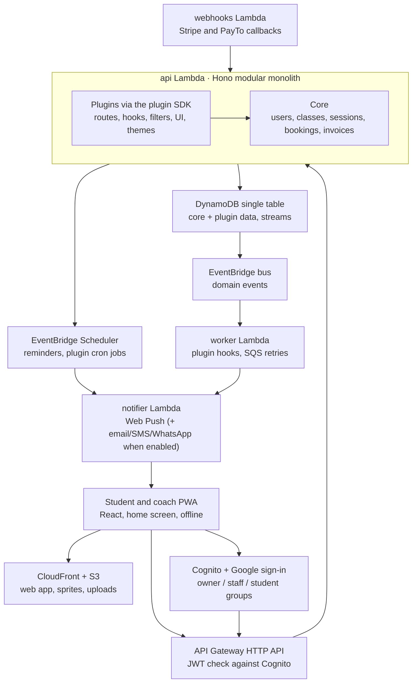
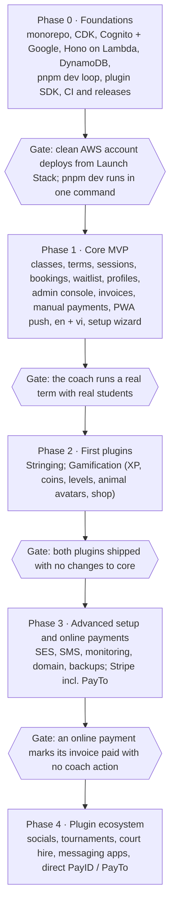

# Racket Club — Design Plan

## Overview

Racket Club is a self-hosted booking app that one badminton coach deploys into their own AWS account in one click. Students sign in with Google and book class sessions. The coach runs everything from an admin console. Everything beyond the core (stringing, gamification, socials, tournaments) ships as code plugins, the way WordPress plugins work. The app is free and open source: each coach runs their own copy and pays only their own AWS bill, and anyone can contribute core fixes or publish plugins. The reference product is [Shuttle Connect](https://www.shuttle-connect.app/), which pitches coaching bookings and racquet restringing in one place.

**Goals**

- A coach with no technical background can deploy, set up and run it, using a Launch Stack button and an in-app setup wizard.
- Runs entirely on AWS serverless services, so it costs close to nothing when idle and scales without ops work.
- A developer can clone the repo and have the app running locally in one command, then build a plugin without touching core code.
- Installable PWA with push reminders for sessions and payments, in English and Vietnamese from day one.

**Non-goals for v1**

- Several coaches in core. One deployment serves one coach; a club with several coaches comes later as a plugin, and many unrelated coaches sharing one deployment (SaaS) is out of scope. The data model keeps a `tenantId` so this stays possible later.
- Native iOS or Android apps. The PWA covers this.
- Third-party plugins installed at runtime from a marketplace. Plugins are compiled in at build time (see Plugin system).

**Personas**

| Persona                   | What they do                                                                  | How they sign in                                |
| ------------------------- | ----------------------------------------------------------------------------- | ----------------------------------------------- |
| Coach (owner)             | Deploys the app, runs setup, creates classes, marks payments, manages plugins | Email + password created at deploy time, MFA on |
| Assistant coach / staff   | Takes attendance, manages bookings, marks payments                            | Invited by the owner, `staff` role              |
| Student                   | Registers, keeps a profile, books sessions, orders stringing, earns rewards   | Google OAuth                                    |
| Parent / guardian (later) | Books and pays for a junior student                                           | Google OAuth, linked to child profiles          |

## Architecture

One static PWA on CloudFront talks to one HTTP API backed by a single Lambda "modular monolith". Core and every plugin run in that same Lambda, share one DynamoDB table, and talk to each other through an EventBridge bus. One Lambda keeps cold starts, permissions and the local dev loop simple. Hot or slow paths (webhooks, image processing, notification fan-out) split into their own small Lambdas.



Requests flow top to bottom through one Lambda; every data change becomes an event that plugin hooks and the notifier pick up, and the notifier pushes back to the phone.

| Layer                 | AWS service                                                     | Why this one                                                                                  |
| --------------------- | --------------------------------------------------------------- | --------------------------------------------------------------------------------------------- |
| Web app hosting       | S3 + CloudFront                                                 | Static PWA, global CDN, free TLS, custom domain via ACM                                       |
| API                   | API Gateway HTTP API                                            | Cheapest API Gateway flavour, native JWT authoriser for Cognito                               |
| Compute               | Lambda (Node.js 22, TypeScript, arm64)                          | One `api` function running a Hono router; separate `worker`, `notifier`, `webhooks` functions |
| Auth                  | Cognito User Pool + Google identity provider                    | Managed Google OAuth, groups for `owner` / `staff` / `student`, MFA for admins                |
| Data                  | DynamoDB (on-demand, single table) + streams                    | Pay per request, no servers, point-in-time recovery on                                        |
| Files                 | S3 (private) behind CloudFront signed URLs                      | Avatars, sprite sheets, plugin assets, coach logo                                             |
| Events                | EventBridge custom bus                                          | Domain events (`booking.created`, `payment.marked_paid`) that plugins subscribe to            |
| Jobs                  | SQS + EventBridge Scheduler                                     | Retries and dead-letter queue; one-off schedules for "session in 2 hours" reminders           |
| Config and secrets    | SSM Parameter Store (SecureString for secrets)                  | Feature flags, enabled plugins, Google and Stripe secrets                                     |
| Notifications         | Web Push (VAPID) from Lambda; SES email; End User Messaging SMS | Push in the base setup; email and SMS in the advanced setup                                   |
| Monitoring (advanced) | CloudWatch dashboards and alarms, X-Ray, AWS Budgets            | Off in the basic setup to keep cost at zero                                                   |

## Tech stack and dev loop

One TypeScript monorepo, one package manager (pnpm), one command to run everything locally: `pnpm dev`. The same Hono app runs on Node locally and on Lambda in AWS, so most work never needs a deploy.

| Concern         | Choice                                                                                 |
| --------------- | -------------------------------------------------------------------------------------- |
| Language        | TypeScript everywhere (web, API, infra, plugins)                                       |
| Frontend        | React + Vite, TanStack Router and Query, Tailwind CSS, `vite-plugin-pwa` (Workbox)     |
| API             | Hono, with Zod schemas shared by client and server; OpenAPI generated from the schemas |
| Data access     | ElectroDB entities on the single DynamoDB table                                        |
| Infrastructure  | AWS CDK v2 (TypeScript), synthesised to a CloudFormation template for one-click deploy |
| i18n            | i18next + ICU message format                                                           |
| Tests           | Vitest (unit), Playwright (end to end), AWS Emulator for integration                   |
| Lint and format | Biome                                                                                  |
| CI/CD           | GitHub Actions: test, build, publish release template and assets                       |

**Repo layout**

```
/apps
  /web            React PWA (student app + /admin console)
  /api            Hono app: core routes, plugin loader, Lambda handlers
/packages
  /core           Domain: users, classes, sessions, bookings, payments
  /plugin-sdk     definePlugin(), hook types, UI slot types, test helpers
  /ui             Shared components and design tokens
  /i18n           Core translation files (en, vi)
/plugins
  /stringing      First-party plugin
  /gamification   First-party plugin
/infra            CDK app: stacks, constructs, setup parameters
/tools            create-plugin generator, seed data, release scripts
```

**The dev loop**

1. `pnpm install`, then `pnpm dev`. This starts Vite, the Hono API on Node with hot reload, and AWS Emulator in Docker. Inside the API process, a local event loop polls the emulator's table stream and worker queue and runs the same publisher and worker code as the Lambdas, so plugin hooks run with the same retries and dead-letter queue as in AWS.
2. Locally, a mock sign-in page lets you pick "Coach", "Staff" or a seeded student, so you never need Google credentials to work on features.
3. `pnpm seed` loads a demo coach, 20 students, a term of classes and some bookings.
4. `pnpm create-plugin socials` scaffolds a new plugin with a manifest, a route, an admin page, translations and a test.
5. `pnpm sandbox` deploys a personal cloud stack (`cdk deploy` with hotswap) when you need real Cognito, push or SES.
6. A pull request runs tests and deploys a preview stack; merging to `main` deploys staging; tagging a release publishes the one-click template.

## Testing

Unit tests are required for every change to core, the plugin SDK and first-party plugins: a pull request cannot merge if they fail or coverage drops below the threshold. Integration and end-to-end tests run on every pull request and must pass before anything reaches `main`. Each layer runs locally with one command: `pnpm test` (unit), `pnpm test:int`, `pnpm test:e2e`.

| Layer             | Tool                                                                     | What it covers                                                                                                                                                                                                                                                              | When it runs                                                      | Gate                                                                               |
| ----------------- | ------------------------------------------------------------------------ | --------------------------------------------------------------------------------------------------------------------------------------------------------------------------------------------------------------------------------------------------------------------------- | ----------------------------------------------------------------- | ---------------------------------------------------------------------------------- |
| Unit              | Vitest, tests next to the code (`*.test.ts`)                             | Pure domain logic: capacity and waitlist rules, pricing and invoices, part payments and credits, XP and coin ledger, level curve, shop purchase rules, notification routing, i18n formatting, React components                                                              | Every commit (watch mode in `pnpm dev`) and every PR              | Required; coverage at least 80% lines for `core` and `plugin-sdk`, 70% for plugins |
| Integration       | Vitest + AWS Emulator (DynamoDB with streams, EventBridge, SQS, S3, SSM) | Each API route with each role (owner, staff, student, signed out); DynamoDB transactions, including 20 parallel bookings for the last spot never overbooking; hooks running once per event (idempotency); plugin migrations; webhook handlers with recorded Stripe payloads | Every PR                                                          | Required                                                                           |
| Plugin contract   | `@app/plugin-sdk/testing`                                                | Every plugin against every extension point it uses: manifest valid, routes guarded, hooks idempotent, settings schema renders, both `en` and `vi` translations complete                                                                                                     | Every PR                                                          | Required                                                                           |
| End-to-end        | Playwright, mock Google sign-in, seeded data                             | Key journeys on mobile and desktop viewports, in English and Vietnamese (list below)                                                                                                                                                                                        | Every PR against its preview stack; full suite nightly on staging | Required before merge to `main`                                                    |
| Infrastructure    | CDK assertions, snapshot tests, cdk-nag                                  | Basic and Advanced templates create the right resources; no public buckets or wildcard IAM; tables retained on delete                                                                                                                                                       | Every PR                                                          | Required                                                                           |
| Deploy smoke test | Launch Stack template in a clean sandbox AWS account                     | One-click deploy completes, setup wizard loads, real Cognito sign-in works, then the stack is deleted                                                                                                                                                                       | Nightly and before each release                                   | Blocks the release                                                                 |
| Accessibility     | axe-core inside Playwright                                               | No serious violations on student and admin pages                                                                                                                                                                                                                            | With end-to-end                                                   | Required                                                                           |

**Local AWS with AWS Emulator**

[AWS Emulator](https://aws.amazon.com/blogs/aws/test-your-applications-against-aws-locally-with-aws-emulator/) (free, open source, released 11 November 2026) serves AWS APIs on `127.0.0.1:9297`. The AWS SDK reaches it through `AWS_ENDPOINT_URL`, so the app needs no code changes. It becomes the backend for `pnpm dev` and for integration tests, replacing DynamoDB Local, because it also covers the event path: DynamoDB streams, EventBridge, SQS and S3 in one process.

| Use it for                                                                                                                                | Don't rely on it for                                                                 | Covered instead by                                        |
| ----------------------------------------------------------------------------------------------------------------------------------------- | ------------------------------------------------------------------------------------ | --------------------------------------------------------- |
| DynamoDB transactions, conditional writes and streams; EventBridge to SQS; SQS retries and dead-letter queues; S3 uploads; SSM parameters | IAM and resource policies (not evaluated like AWS, so a request AWS denies may pass) | cdk-nag in unit tests, plus the nightly real-AWS deploy   |
| Running the API's real data layer and event handlers in integration tests                                                                 | Deploying the whole CDK stack (CloudFormation is its weakest service)                | CDK assertion tests, plus the sandbox and nightly deploys |
| Fast feedback for Claude Code and other agents without an AWS account                                                                     | Cognito sign-in, API Gateway JWT checks, CloudFront                                  | Mock auth locally; Playwright against the preview stack   |

Rules: pin the emulator version in CI and upgrade on purpose; set up tables, buses and queues in test setup with the SDK rather than through CloudFormation; any operation that returns 501 Not Implemented gets a note in `docs/testing.md` and a test against the sandbox instead. The emulator is new and its published fidelity varies by service, so the nightly deploy to real AWS remains the final check.

**End-to-end journeys (first set)**

1. Student signs in, completes onboarding, books a session, cancels before the cut-off.
2. Session is full: student joins the waitlist, a spot frees up, the student is promoted and gets an in-app notification.
3. Coach creates a term class, marks attendance on a phone viewport, marks an invoice paid (part payment, then the rest).
4. Push: the service worker receives a test push from a mocked push service and shows the reminder; the in-app inbox shows it too.
5. Offline: attendance ticked with the network off syncs when it comes back.
6. Plugins: stringing order from request to collected; attendance awards XP, the avatar levels up, the student buys a hat in the shop.
7. Setup wizard from first admin login to the first class.

**Rules that keep tests useful**

- `pnpm create-plugin` scaffolds unit, integration and contract tests, so new plugins start with tests.
- Time is injected (a fake clock), never read directly, so reminder, cut-off and streak logic is testable.
- No test calls real Google, Stripe, Meta or SMS; they use recorded fixtures. Real services are only touched by the nightly deploy smoke test.
- A bug fix includes a test that fails without the fix.

## Data model

All data lives in one DynamoDB table with generic keys (`pk`, `sk`) and two global secondary indexes (`gsi1`, `gsi2`). Every key starts with a tenant prefix (`T#default`) so the app can become multi-coach later without a migration. Plugins get their own key namespace (`P#<pluginId>#…`) so they can never collide with core data or each other.

| Entity                     | pk               | sk                   | Main access patterns                                             |
| -------------------------- | ---------------- | -------------------- | ---------------------------------------------------------------- |
| User (student / staff)     | `USER#<id>`      | `PROFILE`            | Get profile; list students by name (gsi1)                        |
| Class (recurring template) | `CLASS#<id>`     | `META`               | List active classes, level, venue, capacity, price               |
| Session (one occurrence)   | `CLASS#<id>`     | `SESSION#<startIso>` | Upcoming sessions per class; calendar by date (gsi1)             |
| Booking                    | `SESSION#<id>`   | `BOOKING#<userId>`   | Roster per session; a student's bookings (gsi1 = `USER#<id>`)    |
| Waitlist entry             | `SESSION#<id>`   | `WAIT#<ts>#<userId>` | Promote in order when a spot frees up                            |
| Invoice / charge           | `USER#<id>`      | `INVOICE#<id>`       | Unpaid invoices per student; all unpaid (gsi2 = `STATUS#unpaid`) |
| Payment                    | `INVOICE#<id>`   | `PAYMENT#<id>`       | Ledger per invoice: method `manual`, `stripe`, `payto`           |
| Push subscription          | `USER#<id>`      | `PUSH#<hash>`        | Fan-out to all of a student's devices                            |
| Settings                   | `TENANT`         | `SETTINGS`           | Branding, languages, timezone, enabled plugins                   |
| Plugin record              | `P#<pluginId>#…` | plugin-defined       | Owned and migrated by the plugin                                 |

**Rules**

- Money is stored as integer cents plus a currency code (`AUD`). Times are stored as UTC ISO strings, displayed in the coach's timezone (default `Australia/Sydney`).
- Booking a spot uses a DynamoDB transaction: increment the session's `booked` count with a condition `booked < capacity`, and write the booking. No overbooking under race conditions.
- Every write emits a domain event from the DynamoDB stream to EventBridge, so plugins react to changes without core calling them directly.
- Students can download or delete their data from their profile (Australian Privacy Act).

## Core features (bare-bones app)

The bare-bones core does five jobs: sign-in, profiles, class scheduling with bookings, manual payment management, and an admin console. Its only notification channel is PWA push plus an in-app inbox; there is no SMS or email. Everything else is a plugin.

**Student sign-up with Google**

1. Student taps "Continue with Google". Cognito managed login federates to Google and returns tokens to the PWA (authorisation code flow with PKCE).
2. A Cognito post-confirmation trigger creates the `USER` record and adds the student to the `student` group.
3. First login shows a short onboarding form: display name, phone, skill level (beginner to advanced), preferred language, emergency contact, and a junior flag with guardian details.
4. Optional coach setting: "approve new students before they can book".

**Student profile**

- Name, photo (from Google, replaceable), phone, skill level, preferred language, notification preferences.
- My bookings (upcoming and past), attendance history, outstanding balance, payment history.
- Plugin tabs appear here automatically (Avatar and Rewards, My Stringing Orders).

**Classes, sessions and bookings**

- Coach creates a class template: name, level, venue, day and time, duration, capacity, price per session or per term, term start and end dates. The system generates the sessions.
- Students book single sessions or a whole term, join a waitlist when full, and cancel up to a cut-off the coach sets (for example 24 hours).
- Coach can cancel a session (all booked students are notified), move it, or add a one-off session.
- Waitlist auto-promotes the next student and notifies them.

**Admin console (`/admin`)**

| Area                  | What the coach can do                                                                                                                                                                |
| --------------------- | ------------------------------------------------------------------------------------------------------------------------------------------------------------------------------------ |
| Dashboard             | Today's sessions, spots left, unpaid total, new sign-ups                                                                                                                             |
| Schedule              | Calendar of classes and sessions; create, edit, cancel                                                                                                                               |
| Roster and attendance | Per-session roster, tick attendance on a phone at the court                                                                                                                          |
| Students              | Search, view profile, approve, add notes, adjust balance                                                                                                                             |
| Payments              | Invoices per student, unpaid list, mark paid (cash, bank transfer, PayID) including part payments, credits and class packs, refunds, push reminders for overdue invoices, CSV export |
| Messages              | Send an announcement to a class or all students (push, then email or SMS if enabled)                                                                                                 |
| Plugins               | Turn plugins on or off, open each plugin's settings page                                                                                                                             |
| Settings              | Branding (logo, colours, app name), languages, timezone, booking rules, staff accounts                                                                                               |

## Plugin system

Plugins are TypeScript packages compiled into the app at build time and switched on or off at runtime from the admin console. This gives the WordPress feel (drop a folder in, it appears in the Plugins page) without running untrusted code that was uploaded later. Each plugin is one folder exporting one `definePlugin()` object.

**Why build-time, not runtime upload**

- Lambda code is immutable per deploy, and loading code from S3 at runtime is a security hole.
- Type checking catches a broken plugin before it reaches the coach.
- A plugin that is installed but switched off costs nothing: its routes return 404, its hooks are skipped, its menu items are hidden.

**A plugin, end to end**

```ts
// plugins/stringing/index.ts
import { definePlugin, z } from '@app/plugin-sdk';

export default definePlugin({
  id: 'stringing',
  name: { en: 'Stringing service', vi: 'Dịch vụ đan vợt' },
  version: '1.0.0',
  requiresCore: '^1.0.0',
  permissions: ['payments:create-invoice', 'notifications:send'],

  settings: z.object({
    turnaroundDays: z.number().default(2),
    dropOffPoints: z.array(z.string()).default(['At class']),
  }),

  entities: { order: StringingOrder }, // ElectroDB entity in P#stringing#
  routes: (app) => app.route('/orders', ordersRouter), // mounted at /api/p/stringing

  hooks: {
    'booking.created': async (evt, ctx) => {
      /* suggest a restring */
    },
    'payment.marked_paid': async (evt, ctx) => {
      /* mark order paid */
    },
  },
  filters: {
    'profile.tabs': (tabs) => [...tabs, { id: 'stringing', label: 'stringing.tab' }],
  },

  ui: {
    student: { routes: lazy(() => import('./ui/student')), slots: { 'profile.tab': OrdersTab } },
    admin: {
      routes: lazy(() => import('./ui/admin')),
      menu: { label: 'stringing.menu', icon: 'racket' },
    },
  },
  i18n: { en: () => import('./i18n/en.json'), vi: () => import('./i18n/vi.json') },
  migrations: [v1_initial],
  jobs: { 'daily-ready-reminder': { schedule: 'cron(0 8 * * ? *)', run: remindReady } },
});
```

**Extension points**

| Kind                  | How it works                                                                          | Examples                                                                                             |
| --------------------- | ------------------------------------------------------------------------------------- | ---------------------------------------------------------------------------------------------------- |
| Actions (async hooks) | Subscribe to domain events on the EventBridge bus; at-least-once, retried, idempotent | `user.registered`, `booking.created`, `booking.cancelled`, `session.attended`, `payment.marked_paid` |
| Filters (sync hooks)  | Change a value before core uses it, in priority order, with a time budget             | `booking.price`, `profile.tabs`, `notification.content`, `admin.dashboard.cards`                     |
| API routes            | A Hono sub-app mounted at `/api/p/<id>`, with auth and role guards from the SDK       | Stringing orders, shop purchases                                                                     |
| UI slots              | Named places in the React app where plugin components render                          | `profile.tab`, `session.card.footer`, `admin.menu`, `dashboard.widget`, `home.banner`                |
| Pages                 | Lazy-loaded routes under `/p/<id>` and `/admin/p/<id>`                                | Stringing order form, tournament bracket                                                             |
| Data                  | ElectroDB entities in the plugin's own key namespace, with versioned migrations       | Orders, avatar inventory                                                                             |
| Jobs                  | Cron schedules created by the CDK from the manifest                                   | Daily reminders, weekly leaderboard reset                                                            |
| Settings              | A Zod schema rendered automatically as a form in the admin console                    | Turnaround days, coin rates                                                                          |
| Payment provider      | Implements the `PaymentProvider` interface (see Payments)                             | Stripe, PayTo                                                                                        |
| Notification channel  | Implements `NotificationChannel`                                                      | WhatsApp, Facebook Messenger, Zalo (see PWA and notifications)                                       |

**Themes**

The look of the app is a plugin too. A theme plugin is an ordinary plugin with a `theme` field; the coach picks one active theme in Admin, Settings, Appearance, then adjusts colours and logo on top of it with a live preview. All UI components read design tokens (CSS variables), never hard-coded colours, so any theme restyles everything, including other plugins' pages.

| A theme can provide   | How                                                                                                                                       | Example                                            |
| --------------------- | ----------------------------------------------------------------------------------------------------------------------------------------- | -------------------------------------------------- |
| Design tokens         | Colours (light and dark), type scale, fonts, radius, spacing, shadows                                                                     | A "Court Green" theme, a high-contrast theme       |
| Coach-editable fields | A list of which tokens the coach may change in the admin colour pickers                                                                   | Primary colour and logo only                       |
| Component overrides   | Replace a named component (`SessionCard`, `AppHeader`, `BottomNav`, `AvatarFrame`) with its own React component that takes the same props | A pixel-art theme with a retro session card        |
| Layout                | Choose a layout variant: bottom tabs or side menu, compact or roomy cards                                                                 | Tablet layout for the court-side attendance screen |
| Assets                | Fonts, icons, background images, the PWA icon set                                                                                         | Club crest, pixel font with Vietnamese characters  |

The core ships one default theme ("Racket Club"). Colours are checked for contrast (WCAG AA) when the coach saves, so a custom colour cannot make text unreadable. The active theme also generates the PWA manifest colours and icons.

**Lifecycle and safety**

1. **Install**: add the folder (or an npm package name) to `plugins.config.ts`, then deploy. The one-click template ships with all first-party plugins installed and off.
2. **Activate**: the coach flips it on. Core runs pending migrations, registers the plugin's schedules, and shows its menu.
3. **Deactivate**: routes, hooks and UI disappear; data is kept.
4. **Uninstall**: optional data purge, with a confirmation.

Plugins only reach core through the SDK context (`ctx.users`, `ctx.bookings`, `ctx.payments`, `ctx.notify`, `ctx.db`), checked against the `permissions` the manifest declares. A failing hook is logged and retried; it never fails the student's booking. Plugins can depend on each other (`dependsOn: ['gamification']`) and can emit their own events (`stringing.order.ready`) for other plugins to use.

## First plugins

Two first-party plugins ship with v1 and prove the plugin API: Stringing (orders and payments) and Gamification (events, a ledger and rich UI). If both can be built without touching core, the API is good enough for socials and tournaments.

### Stringing service

A student orders a restring, hands the racket over at class, and gets a push when it is ready.

- **Catalogue** (admin): strings (brand, model, gauge, colour, price), labour price, tension range, express surcharge.
- **Order form** (student): racket brand and model, string choice, tension in lbs (mains and crosses), drop-off point ("at my next class" lists their booked sessions), notes. Remembers the last order for a one-tap "same again".
- **Order states**: requested, received, strung, ready, collected, or cancelled. The coach moves orders along on a simple board.
- **Payments**: creating an order raises an invoice through core payments, so it shows in the same unpaid list and can be marked paid like a class.
- **Notifications**: "Your racket is ready, pick it up at Tuesday's class".
- **Events emitted**: `stringing.order.created`, `stringing.order.ready` (the gamification plugin can award coins for these).

### Gamification

Students earn XP to level up a pixel-art avatar and coins to spend in a shop on avatar accessories.

**Earning rules** (all values editable by the coach in plugin settings)

| Trigger (core or plugin event)                      | XP  | Coins |
| --------------------------------------------------- | --- | ----- |
| Book a session (`booking.created`)                  | 2   | 0     |
| Attend a session (`session.attended`)               | 10  | 5     |
| 4-week attendance streak                            | 25  | 15    |
| Pay on time (`payment.marked_paid` before due date) | 5   | 5     |
| Refer a friend who books                            | 20  | 20    |
| Coach award (skill milestone, "great smash today")  | any | any   |
| Stringing order (`stringing.order.created`)         | 0   | 5     |

- XP and coins are an append-only ledger keyed by the source event id, so a retried event never pays twice. Balances are a cached sum.
- Levels follow a curve the coach can tune (for example level n needs 50 × n² XP). Each level can unlock shop items and a badge.
- Badges: first class, 10 classes, 50 classes, perfect month, first tournament (when that plugin exists).
- Optional class leaderboard (off by default, juniors hidden).

**Pixel-art avatar**

- Avatars are animals, starting with a chicken, a cat and a dog (each with colour variants); more animals can be added later as asset packs. Each avatar is layered sprite sheets: animal base, outfit, shoes, racket, headband or hat, plus effects. Each species defines anchor points (head, body, the paw or wing that holds the racket), so one accessory fits all three animals. Each layer is a PNG sheet of 32×32 frames with a JSON frame map exported from Aseprite. v1 ships AI-generated placeholders made to this exact spec (same grid, anchor points and frame order), so real art can be swapped in later with no code changes.
- Animations: idle, walk, smash, celebrate, level-up. Drawn on an HTML canvas with `image-rendering: pixelated`, scaled at whole-number sizes so pixels stay crisp.
- The level-up moment plays a full-screen animation with confetti pixels, then shows the newly unlocked items.
- Sprites live in S3 behind CloudFront. A new accessory is a PNG plus a JSON entry: the coach (or a designer) uploads them in the admin shop, no deploy needed.

**Shop**

- Items: name (en/vi), slot, sprite, coin price, minimum level, limited-time window, stock.
- Purchase is one DynamoDB transaction: deduct coins with a `balance >= price` condition and add the item to the inventory.
- Optional later: let the coach list real rewards (free restring, a club T-shirt) that need staff to fulfil.

### Future plugins (same API)

| Plugin                      | What it needs from the API                                                |
| --------------------------- | ------------------------------------------------------------------------- |
| Social play booking         | Its own session type with casual pricing, court allocation, guest players |
| Tournaments                 | Registration, draws and brackets, scores, results feeding XP and badges   |
| Court hire                  | Court calendar, hourly pricing, venue integration                         |
| Private lessons             | Coach availability slots and 1-on-1 booking                               |
| Memberships and term passes | Recurring invoices through the payment providers                          |
| Skill tracking              | Coach assessments per skill, progress charts on the profile               |

**Multi-coach (clubs).** A plugin turns one deployment into a club: extra coaches get a `coach` role, their own classes, availability and payout reports, while the owner keeps club-wide settings and payments. To keep this possible without a migration, core stores a `coachId` on every class, session and invoice from day one (always the owner in single-coach mode), and every admin query filters by it.

## Payments

v1 is manual: the app raises invoices and the coach marks them paid. Online payment arrives later as provider plugins behind one interface, so the invoice, ledger and "unpaid" views never change.

**Phase 1: manual (v1)**

- Bookings, term enrolments and plugin orders raise an invoice with line items, a due date and a unique short reference (for example `BC-4821`).
- The invoice screen shows the coach's PayID and bank details with that reference, so bank transfers are easy to match.
- Coach marks paid with method (cash, PayID or bank transfer, other), amount (partial allowed) and a note. Every change is an append-only ledger entry with who and when.
- Optional student credit: prepaid balance or a 10-class pack drawn down per booking.
- Reminders go out at the due date and 3 days after (push, then email if enabled).

**The provider interface**

```ts
interface PaymentProvider {
  id: 'manual' | 'stripe' | 'payto' | string;
  createCheckout(
    invoice: Invoice,
    payer: User,
  ): Promise<{ redirectUrl?: string; clientSecret?: string }>;
  handleWebhook(req: Request): Promise<PaymentEvent[]>; // verified signature, idempotent
  refund(payment: Payment, amountCents: number): Promise<void>;
  setupRecurring?(payer: User, mandate: MandateTerms): Promise<Mandate>; // term fees, memberships
}
```

Webhooks land on a dedicated `webhooks` Lambda, are verified, written to the ledger, and published as `payment.succeeded` or `payment.failed` events.

**Phase 2: Stripe plugin**

- Stripe Checkout or Payment Element for cards, Apple Pay and Google Pay. The coach pastes Stripe API keys in plugin settings; keys are stored as SSM SecureString parameters.
- Stripe also supports [PayTo](https://docs.stripe.com/payments/payto): a real-time Australian method for one-time and recurring payments, where the customer approves a mandate in their banking app. Offering PayTo through Stripe avoids the coach having to become a sponsored PayTo user with a bank.
- Option to pass card fees to the student as a surcharge line.

**Phase 3: direct PayID / PayTo (optional)**

Direct PayID / PayTo is a later provider plugin, worth it only once Stripe fees matter at the coach's volume. PayTo runs across all participating Australian banks, so the coach's provider choice does not depend on which bank students use; CommBank matters only if the coach banks there.

| Option                                                                              | What it offers                                                                                | Fit for a serverless, single-coach app                                                                                                                                                                                 |
| ----------------------------------------------------------------------------------- | --------------------------------------------------------------------------------------------- | ---------------------------------------------------------------------------------------------------------------------------------------------------------------------------------------------------------------------- |
| Stripe PayTo (Phase 2)                                                              | PayTo as one more method in Stripe Checkout, one-off and recurring                            | Best first step: no extra contract, same webhooks                                                                                                                                                                      |
| [CommBank PayTo API](https://developer.api.commbank.com.au/apis/payto/introduction) | Create and manage PayTo agreements and payments directly with the bank                        | Poor fit: needs an mTLS certificate from DigiCert ([quick start](https://docs.commbank.com.au/apis/payto/quick-start)) and whitelisted source IPs, so Lambda needs a NAT gateway with a fixed IP, a fixed monthly cost |
| [Azupay](https://azupay.com.au/payid-and-payto)                                     | PayID (single-use PayID per invoice, or one per student) and PayTo, fixed fee per transaction | Good fit: a unique PayID per invoice gives automatic reconciliation                                                                                                                                                    |
| [Monoova](https://www.monoova.com/npp)                                              | PayTo and PayID via API, claims the majority of PayTo agreements in Australia                 | Good fit; compare pricing with Azupay                                                                                                                                                                                  |
| [Zepto](https://g2.com/products/zepto-2022-04-07/pricing)                           | PayTo, PayID, direct debit via one API                                                        | Pricing is bespoke (monthly fee plus per transaction); aimed at larger businesses                                                                                                                                      |

Recommendation: Stripe PayTo in Phase 2; in Phase 3 get quotes from Azupay and Monoova and build the winner as a `PaymentProvider` plugin. Go direct to CommBank only for a hosted multi-coach version, where one fixed-IP setup is shared by many coaches.

## PWA and notifications

The app installs to the home screen and sends standard Web Push from a Lambda, with no third-party push service. On iPhone, push only works once the student has added the app to the home screen (iOS 16.4 or later), so onboarding includes a guided "Add to Home Screen" step ([Pushpad](https://pushpad.xyz/blog/ios-special-requirements-for-web-push-notifications)).

**PWA**

- Web app manifest with the coach's name, icon and theme colour, generated from the branding settings.
- Service worker (Workbox): cache the app shell; cache "my upcoming sessions" and "my bookings" for offline viewing at a court with bad reception; queue attendance ticks made offline and sync them later.
- An install banner on Android and desktop; an illustrated iOS guide (Share, then Add to Home Screen) shown before asking for notification permission.
- Ask for notification permission after the first booking, not on first visit, so more students say yes.

**Notification types**

| Notification                                    | When                                           | Channels                      |
| ----------------------------------------------- | ---------------------------------------------- | ----------------------------- |
| Session reminder                                | 24 h and 2 h before (coach configurable)       | Push; email or SMS if enabled |
| Booking confirmed, cancelled, waitlist promoted | Immediately                                    | Push, email                   |
| Session cancelled or moved by coach             | Immediately                                    | Push, SMS if enabled          |
| Payment due and overdue                         | Due date, then 3 days after                    | Push, email                   |
| Payment received                                | When marked paid or a webhook arrives          | Push                          |
| Plugin notifications                            | Defined by the plugin (racket ready, level up) | Plugin chooses                |

**How it is sent**

- Booking a session creates two one-off EventBridge Scheduler schedules (24 h and 2 h) that invoke the `notifier` Lambda; cancelling deletes them. Daily jobs handle payment reminders.
- `notifier` renders the message in the student's language, respects their per-type preferences and quiet hours, then fans out to all their push subscriptions. Expired subscriptions (HTTP 410) are deleted.
- VAPID keys are generated at deploy time and stored as an SSM SecureString parameter.

**Channels and channel plugins**

In the bare-bones (Basic) setup, Web Push is the only channel, backed by an in-app notification inbox, so a student who declined push or never installed the app still sees every message when they open it. Email and SMS come only with the Advanced setup; messaging apps are channel plugins. Each student picks a preferred channel order in their profile, and the notifier walks it, falling back (for example WhatsApp, then SMS, then push) when a channel fails or the student has not linked it. Urgent types such as a cancelled session can go to every linked channel at once.

```ts
interface NotificationChannel {
  id: 'push' | 'email' | 'sms' | 'whatsapp' | 'messenger' | string;
  link?(user: User): Promise<{ url: string }>; // opt-in flow, e.g. click-to-chat link with a one-time code
  canSend(user: User, msg: OutboundMessage): Promise<boolean>; // linked? inside the platform's rules?
  send(user: User, msg: OutboundMessage): Promise<DeliveryResult>;
  handleInbound?(req: Request): Promise<InboundEvent[]>; // replies such as "CANCEL" or "YES"
}
```

| Channel            | How it is built                                                                                                                                                                                                                                              | What to watch                                                                                                                                                                                                                                                                                |
| ------------------ | ------------------------------------------------------------------------------------------------------------------------------------------------------------------------------------------------------------------------------------------------------------ | -------------------------------------------------------------------------------------------------------------------------------------------------------------------------------------------------------------------------------------------------------------------------------------------- |
| Web Push           | Core, VAPID from Lambda                                                                                                                                                                                                                                      | iPhone needs the app on the home screen                                                                                                                                                                                                                                                      |
| Email              | Core (Advanced), Amazon SES                                                                                                                                                                                                                                  | SES starts in sandbox mode                                                                                                                                                                                                                                                                   |
| SMS                | Core (Advanced), AWS End User Messaging SMS                                                                                                                                                                                                                  | Cost per message; monthly spend limit                                                                                                                                                                                                                                                        |
| WhatsApp           | Plugin, [AWS End User Messaging Social](https://aws.amazon.com/blogs/messaging-and-targeting/send-whatsapp-business-messages-with-aws-end-user-messaging-social/), which links a WhatsApp Business Account to the AWS account and bills messages through AWS | Needs a WhatsApp Business Account and a phone number; messages the business starts must use Meta-approved templates (reminders and payment notices as utility templates)                                                                                                                     |
| Facebook Messenger | Plugin, Messenger Platform Send API through the coach's Facebook Page                                                                                                                                                                                        | Strictest rules: free-form messages only within 24 hours of the student's last message, and Meta retired the event-update message tag in 2026 ([Meta docs](https://developers.facebook.com/docs/messenger-platform/send-messages)), so reminders depend on opt-in notifications or templates |
| Zalo (later)       | Plugin                                                                                                                                                                                                                                                       | Popular with Vietnamese-speaking students                                                                                                                                                                                                                                                    |

Linking a messaging app is always an opt-in by the student: they tap "Connect WhatsApp" in their profile, which opens a chat with a one-time code. That records consent and ties the chat to their account. Inbound replies arrive as events, so a plugin can support "reply CANCEL to cancel this booking".

## Multi-language (English and Vietnamese)

Every word a user sees comes from translation files, from core and from each plugin, and the student's chosen language follows them into notifications and emails.

- i18next with ICU message format for plurals and variables ("{count, plural, one {# spot left} other {# spots left}}").
- Namespaces: `core`, `admin`, and one per plugin, each lazy-loaded. Missing keys fall back to English and are flagged in CI.
- Language is picked from the Google profile on first login, can be changed in the profile, and is stored on the user so server-sent messages use it.
- Dates, times and money are formatted with `Intl` (en-AU and vi-VN). Vietnamese needs fonts with full diacritic support; pixel-art UI text needs a pixel font that includes Vietnamese characters.
- Content the coach types (class names, shop items, announcements) has an optional Vietnamese field; if empty, the English is shown.
- Adding a language later means adding one JSON file per namespace and one entry in settings.

## Infrastructure as code and one-click deploy

All infrastructure is AWS CDK code, and each release is published as a ready-made CloudFormation template behind a "Launch Stack" button. The coach never installs anything: they click the button, fill in a short form in the AWS console, wait about 10 minutes, and get an email with their app link and admin password. Everything else is configured inside the app's setup wizard.

**How the button works**

1. On each tagged release, CI runs `cdk synth` with a synthesiser that points Lambda code and web assets at a public, versioned S3 bucket (one per supported region, starting with Sydney, `ap-southeast-2`). No `cdk bootstrap` is needed in the coach's account.
2. The README and the project website carry a CloudFormation quick-create link with the template URL and a default stack name filled in.
3. A custom resource seeds the database, creates the owner's Cognito user, generates VAPID keys, and builds the web app config.
4. Stack outputs show the app URL; Cognito emails the coach a temporary password.

**Deploy form (CloudFormation parameters)**

| Parameter                 | Basic setup                         | Advanced setup                                                                             |
| ------------------------- | ----------------------------------- | ------------------------------------------------------------------------------------------ |
| Coach email (admin login) | Required                            | Required                                                                                   |
| App name                  | Required                            | Required                                                                                   |
| Setup mode                | `Basic`                             | `Advanced`                                                                                 |
| Custom domain             | Not shown (uses the CloudFront URL) | Optional, with a Route 53 hosted zone or DNS instructions                                  |
| Email notifications (SES) | Off                                 | On: sender address or domain to verify                                                     |
| SMS notifications         | Off                                 | On: monthly spend limit, sender ID                                                         |
| Monitoring                | Off                                 | On: CloudWatch dashboard, alarms on errors and failed payments, X-Ray tracing, alert email |
| Monthly budget alert      | Off                                 | On: amount in AUD                                                                          |
| Backups                   | Point-in-time recovery always on    | Plus AWS Backup daily snapshots kept 35 days                                               |

CloudFormation conditions switch these resources on or off, so Basic creates only the free-tier-friendly core. The coach can switch to Advanced later by updating the stack with new parameter values.

**In-app setup wizard (first admin login)**

1. **Branding**: app name, logo, colours, default language and timezone.
2. **Google sign-in**: a guided page with screenshots. It shows the exact redirect URL to paste into Google Cloud Console and takes the client ID and secret back; a Lambda then configures the Cognito Google provider. Until this is done, students can register with email as a fallback.
3. **Payment details**: PayID, bank account, invoice terms.
4. **First class**: create a class and term with a guided form, or import from a CSV.
5. **Plugins**: switch on Stringing and Gamification, with a preview of each.
6. **Advanced only**: verify the SES sender (DNS records shown, plus a reminder to request SES production access), test an SMS, set alert recipients.
7. **Invite students**: a shareable link and QR code to print at the court.

**Updates and removal**

- The admin console shows the running version and a "New version available" card with release notes. "Update" opens CloudFormation with the new template URL and the existing parameters kept.
- The DynamoDB table and the uploads bucket are set to retain on stack deletion, so deleting the app never deletes student data by accident.
- Developers deploy the same CDK app from the command line (`pnpm deploy --stage prod`), so there is one source of truth for both audiences.

## Security, privacy and cost

The app holds personal data about students, some of them children, so it is private by default, least-privilege, and keeps data in Australia.

**Security and privacy**

- Data stays in the region the coach deploys to (Sydney by default). DynamoDB and S3 are encrypted at rest; everything is HTTPS.
- Cognito groups decide access: `owner`, `staff`, `student`. Every API route declares its role; students can only read their own records. Admin accounts require MFA.
- Each Lambda gets only the IAM permissions it needs. Plugin permissions are checked by the SDK at runtime.
- Webhook signatures are verified; webhook and event handling is idempotent.
- Junior students: guardian consent captured at sign-up, leaderboards hide juniors, no public profiles.
- WAF (managed rule set plus rate limiting) is an Advanced option, since it has a fixed monthly cost.
- A privacy policy template and the student data export and delete features support Australian Privacy Act obligations.

**Running cost (approximate, for one coach with about 100 students)**

For 100 students the Basic setup costs about US$1 a month; the core app is effectively free, and messaging is the only thing that can add real cost. Assumed usage: 100 students, about 650 bookings a month (1.5 per student per week), about 100,000 API requests, 2 reminders per booking. Prices in USD, as AWS bills; checked November 2026.

| Item                                                   | Basic (US$/month)         | Advanced (US$/month)               | Basis                                                                                                                                                                                                                       |
| ------------------------------------------------------ | ------------------------- | ---------------------------------- | --------------------------------------------------------------------------------------------------------------------------------------------------------------------------------------------------------------------------- |
| Lambda (\~100k requests, \~10k GB-seconds)             | 0                         | 0                                  | Always-free: 1M requests and 400,000 GB-seconds a month ([source](https://spot.rackspace.com/blog/aws-free-tier))                                                                                                           |
| API Gateway HTTP API                                   | \~0.15                    | \~0.15                             | \~US$1.3 per million requests in Sydney                                                                                                                                                                                     |
| DynamoDB on-demand (\~300k reads, \~30k writes, <1 GB) | \~0.10                    | \~0.10                             | Always-free covers provisioned capacity only, not on-demand ([source](https://dev.to/kanywst/aws-free-hands-on-build-s3-lambda-dynamodb-on-the-always-free-tier-plus-iam-cloudwatch-and-34le)), but this volume costs cents |
| Cognito (100 users signing in with Google)             | 0                         | 0                                  | 10,000 monthly active users free on Essentials, with no expiry ([AWS](https://aws.amazon.com/cognito/pricing/?z=3))                                                                                                         |
| CloudFront + S3 (web app, sprites)                     | \~0.10                    | \~0.10                             | CloudFront is always-free at this volume; S3 storage is cents                                                                                                                                                               |
| EventBridge, Scheduler, SQS, SSM parameters            | 0                         | 0                                  | Inside free allowances                                                                                                                                                                                                      |
| Web Push (\~1,300 reminders)                           | 0                         | 0                                  | Sent from Lambda, no per-message fee                                                                                                                                                                                        |
| Email via SES (\~1,500 emails)                         | n/a                       | \~0.15                             | US$0.10 per 1,000                                                                                                                                                                                                           |
| CloudWatch dashboard, \~10 alarms, logs, X-Ray         | n/a                       | \~0–1                              | Mostly within free allowances                                                                                                                                                                                               |
| Route 53 hosted zone (custom domain)                   | n/a                       | 0.50                               | Plus the domain itself, \~US$15–25 a year                                                                                                                                                                                   |
| AWS Backup daily snapshots                             | n/a                       | \~0.10                             | Small table                                                                                                                                                                                                                 |
| WAF (optional)                                         | n/a                       | \~8                                | 1 web ACL + 3 managed rules                                                                                                                                                                                                 |
| **Total**                                              | **\~US$0.35 (under A$1)** | **\~US$1.50, or \~US$10 with WAF** |                                                                                                                                                                                                                             |

**Optional messaging, on top**

| Channel                            | If used for all \~1,300 reminders                                                                                                                         | If used only for urgent messages (\~50) |
| ---------------------------------- | --------------------------------------------------------------------------------------------------------------------------------------------------------- | --------------------------------------- |
| SMS (AWS End User Messaging)       | \~US$55–65                                                                                                                                                | \~US$2–3                                |
| WhatsApp utility template (plugin) | \~US$15–20 (Meta utility rate in Australia \~US$0.0113 per message ([source](https://whautomate.com/whatsapp-business-api-pricing)) plus a small AWS fee) | \~US$1                                  |
| Web Push                           | Free                                                                                                                                                      | Free                                    |

The design therefore defaults reminders to Web Push and email, and keeps SMS for urgent messages with a hard spend cap. New AWS accounts also get US$100–200 in credits; the coach should pick the Paid account plan, because the Free plan ends after 6 months. Re-check figures against the AWS pricing calculator before launch.

## Roadmap

Build in five phases, each closed by a gate. The coach can use the app for real at the end of Phase 1; plugins come only once the core has run a real term.



Phase 1 is the one to protect: it is the smallest version a coach can run classes on, so plugin work waits until its gate is met.

## Risks and open questions

| Risk                                                         | Impact                                         | Mitigation                                                                                                                |
| ------------------------------------------------------------ | ---------------------------------------------- | ------------------------------------------------------------------------------------------------------------------------- |
| Coach has to create an AWS account and a Google OAuth client | Biggest drop-off point for non-technical users | Step-by-step guide with screenshots; email sign-in works until Google is set up; a setup video and a community help forum |
| iPhone students skip "Add to Home Screen"                    | No push reminders on iOS                       | Guided install step, email or SMS fallback, reminders also shown in-app                                                   |
| Plugin API changes break plugins                             | Upgrades get scary                             | Semantic versioning of the SDK, `requiresCore` check at build time, contract tests for each extension point               |
| SES starts in sandbox mode                                   | Emails only reach verified addresses           | Wizard reminds the coach to request production access; push works meanwhile                                               |
| SMS costs spike                                              | Unexpected bill                                | Hard monthly spend limit, SMS only for urgent types                                                                       |
| One Lambda grows too large                                   | Slower cold starts                             | Lazy-load plugin modules; split a plugin into its own function if needed                                                  |

**Open questions**

- [ ] Decided: core stays single-coach per deployment; a multi-coach plugin adds clubs with several coaches later (see Future plugins).
- [ ] Decided: both term enrolment and pay-per-session at launch.
- [ ] Decided: AI-generated placeholder sprites for the base set (chicken, cat and dog, 10 to 15 starter accessories, 5 animations) for now; real art can replace them later.
- [ ] Researched: Stripe PayTo first, then quotes from Azupay and Monoova (see Payments, Phase 3).
- [ ] Decided: students under 18 sign in themselves; guardian contact details and consent are captured at onboarding.
- [ ] Decided: MIT licence. Project name: Racket Club. Each coach sets their own app name, logo and colours at deploy time and in the setup wizard, so their students see the coach's brand, not "Racket Club".
- [ ] Decided: no hosted SaaS for now. The app stays free, open source and self-hosted; core keeps the cheap tenant prefix on keys so a hosted edition stays possible.
